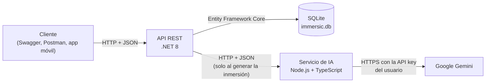
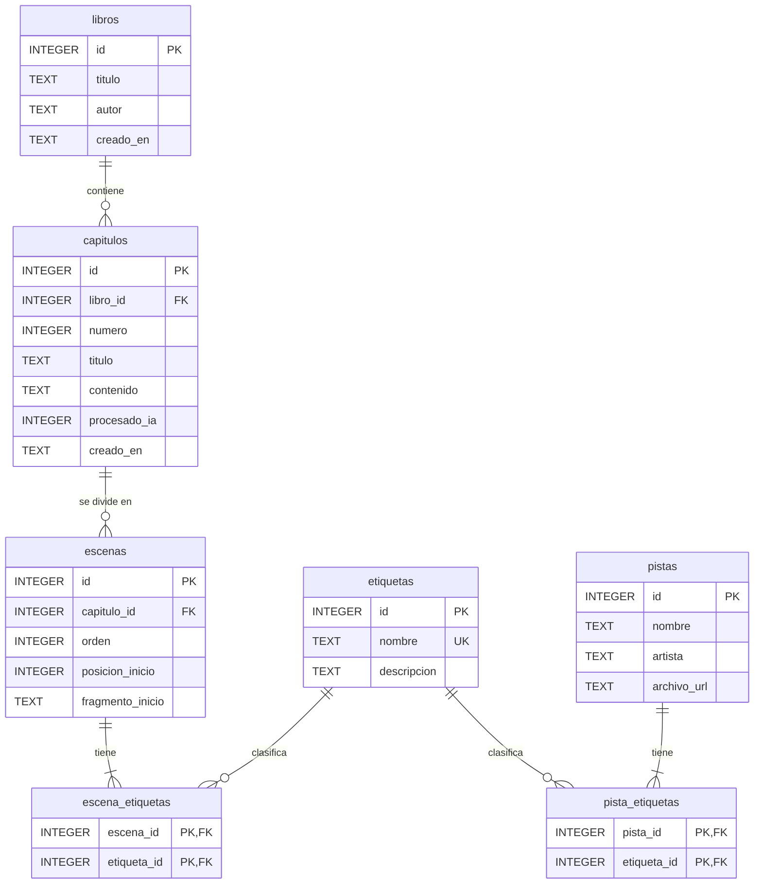

# Immersic Reader — API REST

Backend de **Immersic Reader**, una aplicación de lectura que divide cada capítulo en escenas con ayuda de IA (Google Gemini) y recomienda música según la emoción de cada escena.

Esta entrega incluye la API REST con persistencia en SQLite y el servicio de análisis con IA. No incluye interfaz gráfica: todo se prueba desde Swagger.

## Arquitectura



- **API REST (`api/`)**: CRUD de libros, capítulos, etiquetas y pistas; escenas; recomendaciones de música y plan de inmersión. Documentada con Swagger.
- **Servicio de IA (`servicio-ia/`)**: recibe el texto de un capítulo, le pide a Gemini que lo divida en escenas con etiquetas de emoción y ubica cada escena en el texto. No guarda datos.

## Tecnologías

| Parte | Tecnología |
| --- | --- |
| API | .NET 8 (ASP.NET Core Web API), Entity Framework Core 8 |
| Base de datos | SQLite |
| Documentación | Swagger / OpenAPI (Swashbuckle) |
| Servicio de IA | Node.js 20+ y TypeScript, sin dependencias de ejecución |
| IA | Gemini API (modelo configurable, por defecto `gemini-3.5-flash`) |

## Estructura del repositorio

```text
api/                    API REST (.NET 8)
  Controladores/        Endpoints
  Datos/                DbContext e inicialización de la base de datos
  Dtos/                 Modelos de entrada y salida
  Modelos/              Entidades (una por tabla)
  Servicios/            Reglas de negocio, recomendador y cliente del servicio de IA
servicio-ia/            Servicio de análisis con Gemini (Node.js + TypeScript)
  src/                  Código fuente
  test/                 Pruebas con un Gemini simulado
database/schema.sql     Script DDL de la base de datos
docs/                   Documentación del modelo de datos
scripts/prueba-humo.sh  Prueba de punta a punta
```

## Requisitos

- [.NET SDK 8](https://dotnet.microsoft.com/download) o superior (`dotnet --version`).
- [Node.js 20](https://nodejs.org) o superior (`node --version`).
- Opcional: una API key de Gemini, solo para generar inmersiones. Se obtiene gratis en [Google AI Studio](https://aistudio.google.com/apikey).

## Cómo ejecutar

### 1. Servicio de IA

```bash
cd servicio-ia
npm install
npm run build
npm start
```

Queda escuchando en `http://localhost:3001`.

### 2. API

En otra terminal:

```bash
cd api
dotnet run
```

Swagger queda disponible en **http://localhost:5080/swagger**.

La base de datos `api/immersic.db` se crea sola la primera vez que arranca la API: al iniciar se ejecuta `database/schema.sql`, que crea las tablas que falten y carga las 12 etiquetas de emoción.

El CRUD funciona aunque el servicio de IA esté apagado. Solo `POST /api/capitulos/{id}/inmersion` lo necesita.

## Base de datos

- **Motor:** SQLite, un solo archivo (`immersic.db`).
- **Conexión:** cadena `ConnectionStrings:Immersic` en `api/appsettings.json` (por defecto `Data Source=immersic.db`). Se puede cambiar con la variable de entorno `ConnectionStrings__Immersic`. Las rutas relativas se toman desde la carpeta `api/`. Las llaves foráneas siempre se activan.
- **Script DDL:** [`database/schema.sql`](database/schema.sql). La API lo ejecuta al iniciar, y también se puede ejecutar a mano:

  ```bash
  sqlite3 immersic.db < database/schema.sql
  ```

- **Cambios respecto al documento de diseño:** [`docs/cambios-modelo-datos.md`](docs/cambios-modelo-datos.md).

### Modelo entidad-relación



| Tabla | Tipo | Descripción |
| --- | --- | --- |
| `libros` | Maestra | Libros de la biblioteca. |
| `capitulos` | Maestra | Capítulos de cada libro, con su texto (hasta 60.000 caracteres). |
| `etiquetas` | Maestra | Catálogo de emociones (12 iniciales: suspenso, accion, calma, misterio, perdida, romance, terror, epico, feliz, triste, combate e intenso). |
| `pistas` | Maestra | Pistas de música registradas por el usuario. |
| `escenas` | Transaccional | Escenas de cada capítulo, generadas por la IA o registradas a mano. |
| `escena_etiquetas` | Relación N:M | De 1 a 3 etiquetas por escena. |
| `pista_etiquetas` | Relación N:M | De 1 a 3 etiquetas por pista. |

Integridad:

- Borrar un libro borra sus capítulos, y borrar un capítulo borra sus escenas (`ON DELETE CASCADE`).
- Una etiqueta asignada a una pista o escena no se puede borrar (`ON DELETE RESTRICT`).
- No se repiten el número de capítulo dentro de un libro, la posición de inicio de una escena dentro de un capítulo ni el nombre de una etiqueta.

## Variables de entorno

**API (`api/`)**

| Variable | Valor por defecto | Descripción |
| --- | --- | --- |
| `ConnectionStrings__Immersic` | `Data Source=immersic.db` | Cadena de conexión de SQLite |
| `ServicioIa__UrlBase` | `http://localhost:3001/` | URL del servicio de IA |
| `ServicioIa__TiempoEsperaSegundos` | `180` | Tiempo máximo de espera al servicio de IA |
| `ASPNETCORE_URLS` | `http://localhost:5080` | Dirección en la que escucha la API |

**Servicio de IA (`servicio-ia/`)**

| Variable | Valor por defecto | Descripción |
| --- | --- | --- |
| `PORT` | `3001` | Puerto del servicio |
| `GEMINI_MODELO` | `gemini-3.5-flash` | Modelo de Gemini |
| `GEMINI_TIEMPO_ESPERA_MS` | `150000` | Tiempo máximo de espera a Gemini |
| `MAX_CARACTERES` | `60000` | Longitud máxima del texto a analizar |
| `GEMINI_URL_BASE` | `https://generativelanguage.googleapis.com/v1beta` | URL base de la API de Gemini |

Ejemplo en PowerShell:

```powershell
$env:ConnectionStrings__Immersic = "Data Source=C:\datos\immersic.db"
dotnet run
```

Ejemplo en Bash:

```bash
ConnectionStrings__Immersic="Data Source=/tmp/immersic.db" dotnet run
```

## API key de Gemini

Cada usuario usa su propia API key de Gemini. Se envía en el header `X-Gemini-Api-Key` de `POST /api/capitulos/{id}/inmersion`: la API la reenvía al servicio de IA, y este a Gemini. La key **no se guarda** en la base de datos ni aparece en los registros.

En Swagger, ese endpoint muestra un campo `X-Gemini-Api-Key` donde se pega la key.

## Endpoints

| Método | Ruta | Descripción |
| --- | --- | --- |
| GET | `/api/salud` | Estado de la API, la base de datos y el servicio de IA |
| GET | `/api/libros?buscar=` | Lista los libros (filtro opcional por título o autor) |
| GET | `/api/libros/{id}` | Obtiene un libro |
| POST | `/api/libros` | Crea un libro |
| PUT | `/api/libros/{id}` | Actualiza un libro |
| DELETE | `/api/libros/{id}` | Elimina un libro con sus capítulos |
| GET | `/api/libros/{libroId}/capitulos` | Lista los capítulos de un libro |
| POST | `/api/libros/{libroId}/capitulos` | Crea un capítulo |
| GET | `/api/capitulos/{id}` | Obtiene un capítulo con su contenido |
| PUT | `/api/capitulos/{id}` | Actualiza un capítulo (si cambia el texto, borra sus escenas) |
| DELETE | `/api/capitulos/{id}` | Elimina un capítulo |
| GET | `/api/etiquetas` | Lista las etiquetas |
| GET | `/api/etiquetas/{id}` | Obtiene una etiqueta |
| POST | `/api/etiquetas` | Crea una etiqueta |
| PUT | `/api/etiquetas/{id}` | Actualiza una etiqueta |
| DELETE | `/api/etiquetas/{id}` | Elimina una etiqueta que no esté en uso |
| GET | `/api/pistas?buscar=&etiqueta=` | Lista las pistas (filtros por texto y por etiqueta) |
| GET | `/api/pistas/{id}` | Obtiene una pista |
| POST | `/api/pistas` | Registra una pista con 1 a 3 etiquetas |
| PUT | `/api/pistas/{id}` | Actualiza una pista y sus etiquetas |
| DELETE | `/api/pistas/{id}` | Elimina una pista |
| POST | `/api/capitulos/{id}/inmersion` | Genera las escenas del capítulo con Gemini |
| GET | `/api/capitulos/{id}/inmersion` | Plan de inmersión: la pista recomendada para cada escena |
| GET | `/api/capitulos/{capituloId}/escenas` | Lista las escenas de un capítulo |
| POST | `/api/capitulos/{capituloId}/escenas` | Registra una escena a mano (sin IA) |
| DELETE | `/api/capitulos/{capituloId}/escenas` | Elimina las escenas de un capítulo |
| GET | `/api/escenas/{id}/recomendaciones?limite=` | Pistas recomendadas para una escena |

Los errores se devuelven en formato *Problem Details* (RFC 7807):

| Código | Cuándo |
| --- | --- |
| 400 | Datos inválidos o falta la API key de Gemini |
| 401 / 403 | Gemini rechazó la API key |
| 404 | El recurso no existe |
| 409 | Conflicto: número de capítulo repetido, etiqueta duplicada o en uso, escena repetida |
| 422 | Capítulo vacío o contenido bloqueado por Gemini |
| 429 | Se agotó la cuota de la API key de Gemini |
| 502 / 503 / 504 | Falla, ausencia o demora del servicio de IA o de Gemini |

### Reglas de negocio

- Cada pista y cada escena tiene de 1 a 3 etiquetas. `intenso` refuerza a otra etiqueta y no puede ir sola.
- La afinidad entre una escena y una pista es la cantidad de etiquetas que comparten. Una pista solo se recomienda si comparte al menos una etiqueta distinta de `intenso`.
- Si cambia el texto de un capítulo, se borran sus escenas, porque sus posiciones dejan de coincidir.
- Generar la inmersión reemplaza las escenas anteriores del capítulo dentro de una transacción: si Gemini falla, no se modifica nada.

## Prueba rápida en Swagger

1. `GET /api/etiquetas` para ver los ids de las etiquetas.
2. `POST /api/libros` para crear un libro.
3. `POST /api/libros/{libroId}/capitulos` con el texto del capítulo en `contenido`.
4. `POST /api/pistas` para registrar algunas pistas con sus `etiquetaIds`.
5. `POST /api/capitulos/{id}/inmersion` con la API key en `X-Gemini-Api-Key`. Sin key, se pueden crear escenas a mano con `POST /api/capitulos/{capituloId}/escenas`.
6. `GET /api/capitulos/{id}/inmersion` para ver qué pista suena en cada escena.

## Servicio de IA

| Método | Ruta | Descripción |
| --- | --- | --- |
| GET | `/salud` | Estado del servicio y modelo configurado |
| POST | `/api/analizar` | Recibe `{ texto, etiquetas }` y el header `X-Gemini-Api-Key`; devuelve las escenas con su posición en el texto |

El servicio pide a Gemini una respuesta JSON con un esquema fijo, limita las etiquetas a las del catálogo y ubica cada escena buscando su fragmento inicial en el texto, tolerando diferencias de tildes, mayúsculas, comillas y espacios. El texto del capítulo se envía delimitado y con la instrucción de ignorar cualquier orden que contenga.

## Pruebas

```bash
cd servicio-ia
npm test
```

Ejecuta las pruebas del servicio de IA contra un Gemini simulado: ubicación de escenas, validaciones y manejo de errores (key inválida, cuota agotada, tiempo de espera, contenido bloqueado).

Con ambos proyectos compilados, `bash scripts/prueba-humo.sh` levanta la API, el servicio de IA y un Gemini simulado, y recorre todos los endpoints. GitHub Actions ejecuta ambas pruebas en cada push.
