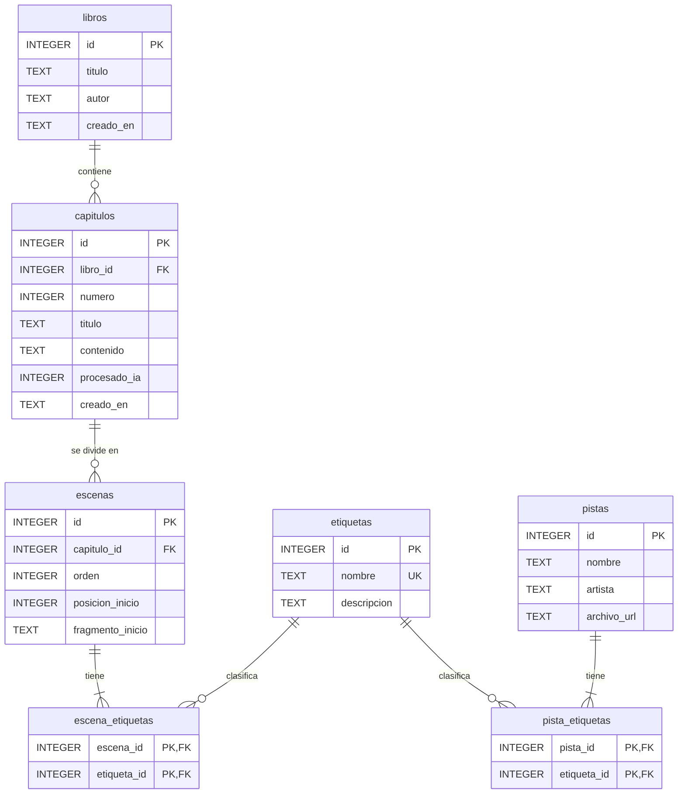

# Cambios en el modelo de datos

| | |
| --- | --- |
| **Proyecto** | Immersic Reader — backend REST con persistencia |
| **Autor** | Marlon Alzate Leyva |
| **Curso** | Programación de Dispositivos Móviles — Institución Universitaria Pascual Bravo |
| **Docente** | Omar Andrés Cardona Zapata |
| **Fecha** | Octubre de 2026 |

## 1. Propósito

Este documento describe los cambios hechos al modelo de datos del documento de diseño *Immersic App* (agosto de 2026) para la entrega del backend REST con persistencia.

Esta entrega es una versión reducida del producto. Se concentra en lo esencial de la inmersión: libros, capítulos, escenas generadas por IA, etiquetas de emoción y pistas de música. No incluye interfaz gráfica, sonidos de ambiente ni configuración.

## 2. Resumen

| Aspecto | Documento original | Esta versión |
| --- | --- | --- |
| Motor de base de datos | PostgreSQL en el servidor y SQLite local | SQLite (un solo archivo) |
| Número de tablas | 8 | 7 |
| Relaciones libro–capítulo y capítulo–escena | N:M en el diagrama | 1:N |
| Seguimiento del procesamiento con IA | Tabla `ProcesamientoCapitulo` | Se elimina; la generación se guarda en una transacción |
| Texto de cada escena | Copia del texto en `texto_escena` | Posición dentro del capítulo (`posicion_inicio`) y primeras palabras (`fragmento_inicio`) |
| Compatibilidad escena–etiqueta | Campo `compatibilidad` | Se calcula al recomendar, contando etiquetas en común |
| Tipos de etiqueta y audios de sistema | `Etiqueta.Tipo`, `PistasAudio.tipo` y `es_sistema` | Se eliminan junto con los sonidos de ambiente |
| API key de Gemini | Guardada y cifrada | No se guarda: cada usuario envía la suya en cada solicitud |

## 3. Modelo original

Tablas del diagrama relacional del documento de diseño:

| Tabla | Campos |
| --- | --- |
| Libro | Id, titulo, autor, creado_en |
| Capitulo | Id, libro_id, numero_capitulo, titulo, contenido_texto, procesado_ia, creado_en |
| ProcesamientoCapitulo | id, capitulo_id, estado, posicion_caracter, ultimo_orden_escena, mensaje_error, actualizado_en |
| Escena | Id, capitulo_id, orden, texto_escena |
| EscenaEtiqueta | escena_id, etiqueta_id, compatibilidad |
| Etiqueta | Id, Tipo, Nombre |
| PistaEtiqueta | pista_id, etiqueta_id |
| PistasAudio | Id, nombre, archivo_ruta, tipo, es_sistema |

## 4. Modelo nuevo

El script completo está en [`database/schema.sql`](../database/schema.sql).

## 5. Cambios por tabla

Los nombres de las tablas pasan a minúsculas y en plural, y todos los campos usan `snake_case`.

### 5.1 `Libro` → `libros`

Se mantiene igual: `id`, `titulo`, `autor` (opcional) y `creado_en`. Se agregan límites de longitud: título de 1 a 150 caracteres y autor de hasta 100.

### 5.2 `Capitulo` → `capitulos`

| Antes | Ahora | Motivo |
| --- | --- | --- |
| `numero_capitulo` | `numero` | Nombre más corto; el contexto ya indica que es del capítulo. |
| `contenido_texto` | `contenido` | Igual que el anterior. Se limita a 60.000 caracteres para controlar el tamaño de cada solicitud a Gemini. |
| `procesado_ia` | `procesado_ia` | Se mantiene. Vuelve a 0 si el texto cambia. |
| — | `UNIQUE (libro_id, numero)` | Un libro no puede tener dos capítulos con el mismo número. |

### 5.3 `ProcesamientoCapitulo` → se elimina

En el diseño original esta tabla guardaba el avance de la IA para retomar el análisis si se acababan los tokens a mitad de un capítulo. En esta versión el capítulo completo se envía en una sola solicitud a Gemini, y las escenas se guardan dentro de una transacción: si Gemini falla, por ejemplo porque se agotó la cuota, no se modifica nada y basta con volver a intentarlo. Sin resultados parciales, la tabla deja de ser necesaria.

### 5.4 `Escena` → `escenas`

| Antes | Ahora | Motivo |
| --- | --- | --- |
| `orden` | `orden` | Se mantiene: 1, 2, 3… según la posición en el capítulo. |
| `texto_escena` | `posicion_inicio` + `fragmento_inicio` | Guardar el texto de cada escena duplicaba el contenido del capítulo. Ahora se guarda el índice del carácter donde empieza la escena y sus primeras palabras. La escena termina donde empieza la siguiente. |
| — | `UNIQUE (capitulo_id, posicion_inicio)` | Dos escenas de un mismo capítulo no pueden empezar en el mismo punto. |

### 5.5 `EscenaEtiqueta` → `escena_etiquetas`

Se elimina el campo `compatibilidad`. La IA solo asigna de 1 a 3 etiquetas a cada escena, sin pesos. La compatibilidad con cada pista se calcula al momento de recomendar, contando las etiquetas en común.

### 5.6 `Etiqueta` → `etiquetas`

| Antes | Ahora | Motivo |
| --- | --- | --- |
| `Tipo` | — | Servía para separar emociones de sonidos de ambiente. Los ambientes no hacen parte de esta versión. |
| `Nombre` | `nombre` | Único, sin distinguir mayúsculas, y se guarda en minúsculas. |
| — | `descripcion` | Se envía a Gemini para que sepa cuándo aplicar cada emoción. |

La tabla arranca con un catálogo de 12 emociones: suspenso, accion, calma, misterio, perdida, romance, terror, epico, feliz, triste, combate e intenso. `intenso` funciona como modificador: refuerza otra etiqueta y no puede ir sola.

### 5.7 `PistasAudio` → `pistas`

| Antes | Ahora | Motivo |
| --- | --- | --- |
| `nombre` | `nombre` | Se mantiene. |
| `archivo_ruta` | `archivo_url` | Puede ser una ruta del dispositivo o una URL. Es opcional en la API. |
| `tipo`, `es_sistema` | — | Distinguían música de sonidos de ambiente predefinidos, que salen de esta versión. |
| — | `artista` | Dato opcional para identificar mejor la pista. |

### 5.8 `PistaEtiqueta` → `pista_etiquetas`

Se mantiene como tabla puente. Cada pista debe tener de 1 a 3 etiquetas.

## 6. Relaciones e integridad

En el diagrama original todas las relaciones estaban marcadas como N:M. En esta versión cada una tiene la cardinalidad que corresponde:

| Relación | Diagrama original | Ahora |
| --- | --- | --- |
| Libro – Capítulo | N:M | 1:N. Cada capítulo pertenece a un solo libro. Borrar un libro borra sus capítulos. |
| Capítulo – Escena | N:M | 1:N. Cada escena pertenece a un solo capítulo. Borrar un capítulo borra sus escenas. |
| Capítulo – ProcesamientoCapitulo | N:N | Se elimina con la tabla. |
| Escena – Etiqueta | N:M | N:M a través de `escena_etiquetas`. Borrar una escena borra sus relaciones. |
| Pista – Etiqueta | N:M | N:M a través de `pista_etiquetas`. Borrar una pista borra sus relaciones. |

Restricciones nuevas en la base de datos:

- Llaves foráneas con `ON DELETE CASCADE` desde libros, capítulos, escenas y pistas.
- `ON DELETE RESTRICT` hacia `etiquetas`: una etiqueta en uso no se puede borrar.
- `CHECK` de longitudes de texto, `numero >= 1`, `orden >= 1`, `posicion_inicio >= 0` y `procesado_ia` en 0 o 1.
- Índices en `etiqueta_id` de las tablas puente, para filtrar pistas y escenas por etiqueta.

## 7. Requerimientos que cambian

| Requerimiento original | En esta versión |
| --- | --- |
| Habrá cifrado de la llave para los tokens. | La API no guarda llaves. Cada usuario usa su propia API key de Gemini y la envía en el header `X-Gemini-Api-Key` de la solicitud que genera la inmersión. Sin llave almacenada, no hay nada que cifrar en la base de datos. |
| Habrá guardado en caso de que los tokens de la IA se acaben en medio de una interacción. | Se reemplaza por una transacción: si la generación falla, el capítulo queda como estaba. |
| Se validará un límite de 5 capítulos por día por aplicación. | Se elimina, porque cada usuario consume la cuota de su propia API key. |
| Menú de ambiente con sonidos predefinidos. | Fuera del alcance de esta versión; por eso se eliminan `Etiqueta.Tipo`, `PistasAudio.tipo` y `PistasAudio.es_sistema`. |

## 8. Motor de base de datos

El documento original planteaba PostgreSQL en el servidor y SQLite en el dispositivo. Como esta versión no tiene usuarios ni sincronización, se usa solo SQLite: no requiere instalar un servidor y la base de datos es un único archivo que la API crea al iniciar con `database/schema.sql`. Las tablas se acceden con Entity Framework Core, y el script DDL se mantiene como la definición oficial del esquema.
